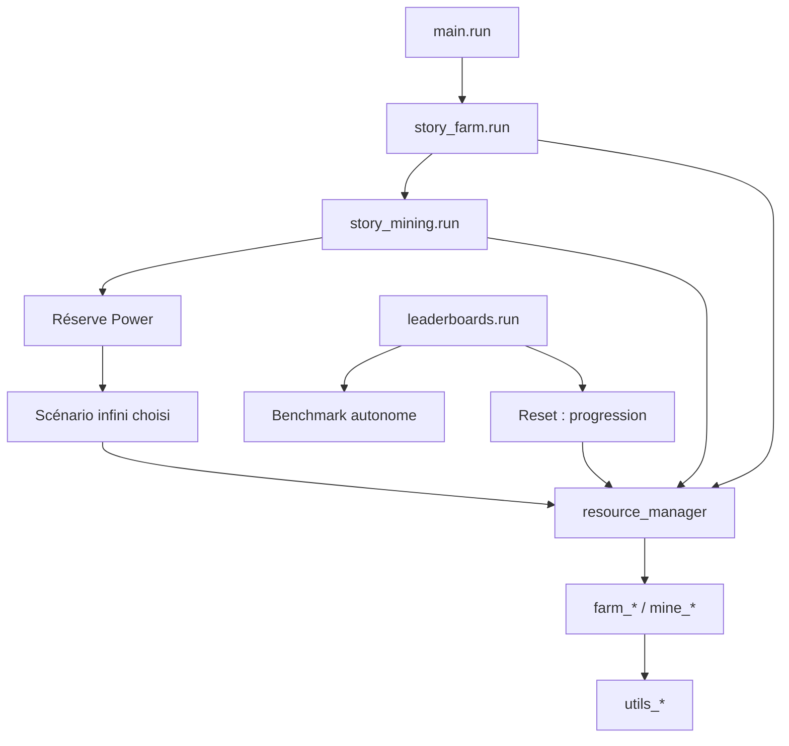

# Architecture

Les scripts actifs sont dans [Save0](../../Save0/) ; `Save0-EA` reste une archive.
Les fichiers s’importent sans lancer leur scénario : l’exécution passe par `run()`
ou la garde `__name__ == "__main__"`.

## Responsabilités

| Famille | Rôle |
| --- | --- |
| `main` | Histoires ferme puis mine, réserve Power, puis un mode infini |
| `story_farm`, `story_mining` | Ordre des upgrades ; coûts lus avec `get_cost()` |
| `story_infinite` | Objectifs de stocks croissants, ressources sélectionnables |
| `story_mining_infinite*` | Monde minier partagé ou descente profonde ; [modes](../guides/mining.md) |
| `resource_manager` | Choix du producteur et financement de ses dépendances |
| `farm_<ressource>`, `mine_<ressource>` | Algorithme single/multi d’une ressource |
| `leaderboard_<ressource>[_single]` | Benchmarks autonomes ; [lancement](../benchmarks/README.md) |
| `leaderboard_fastest[_underground]_reset` | Campagnes de progression, utilisant les producteurs |
| `utils_farm`, `utils_mine`, `utils_move` | Actions, phases, workers et navigation |
| `utils_math`, `utils_debug` | Calculs et diagnostics manuels |
| `ZZAchievementDLC` | Scénarios de succès conservés pour les appels manuels |



Chaque étape de `main` exige le succès de la précédente. Les boucles de production
financent leurs besoins avant de préparer le terrain et rejoignent leurs enfants
avant tout changement de monde. Les benchmarks par ressource gardent leur code
dans leur propre fichier pour rester indépendants des changements de progression.

## Interface des producteurs

Les noms publics sont volontairement identiques entre modules :

```python
import farm_hay
import resource_manager

farm_hay.farm_multi(1000)
resource_manager.farm_current(Items.Coal, 500000)
```

`farm_*` vise un stock absolu ; `produce_*` réalise un lot fini. Le gestionnaire
charge le producteur seulement si son stock manque. Voir les
[contrats et particularités](contracts.md) avant de modifier cette interface.

## Outils hôte

`tools/` utilise Python normal : extraction des références, export CSV Steam et
tests de contrats. `scripts/` synchronise les fichiers selon `.env`. Ces outils
ne sont pas importés par le langage du jeu. Installation, synchronisation et
vérifications sont dans [CONTRIBUTING](../../CONTRIBUTING.md).
